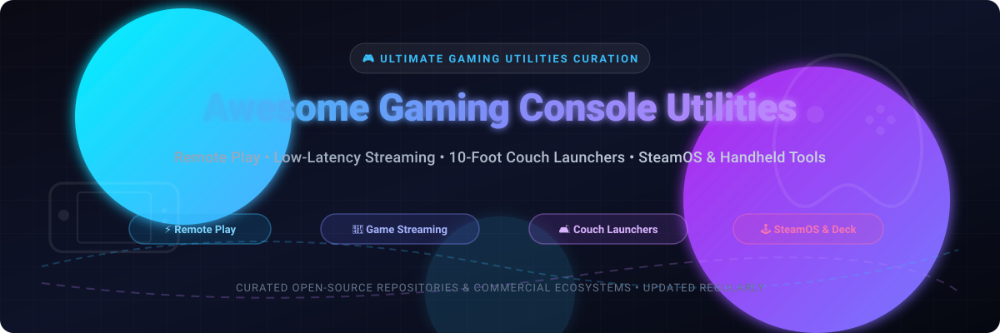

# 🎮 Awesome Gaming Console Utilities

  

  
  
  
  
  

---

## 🕹️ Curated Gaming & Console Companion Utilities

A comprehensive, SEO-optimized, and curated directory of top-tier **open-source tools**, **SaaS game streaming platforms**, **handheld operating systems**, and **living-room console utilities**. Whether you are optimizing a Steam Deck, building a living-room console PC (HTPC), streaming high-FPS games over Moonlight/Sunshine, remapping DualSense/Xbox gamepads, or managing homebrew console hardware, this repository covers the ultimate software toolkit.

> **Keywords / Tags**: `gaming`, `game-streaming`, `remote-play`, `gamepad`, `steamos`, `bazzite`, `moonlight`, `sunshine`, `retroarch`, `playnite`, `handheld-gaming`, `console-utilities`, `awesome-list`

---

## 📑 Table of Contents

- [📊 Sector Overview & Market Dynamics](#-sector-overview--market-dynamics)
- [☁️ SaaS & Commercial Game Streaming Platforms](#️-saas--commercial-game-streaming-platforms)
- [💻 Open-Source Console & Gaming Utilities](#-open-source-console--gaming-utilities)
- [📈 Star History](#-star-history)
- [🛠️ How to Contribute](#️-how-to-contribute)
- [💖 Support & Sponsorship](#-support--sponsorship)
- [⚠️ Disclaimer](#️-disclaimer)

---

## 📊 Sector Overview & Market Dynamics

The global Gaming Platforms, Game Streaming, and Companion Software market is estimated at **$5.0B–$6.5B in 2026** for cloud/remote gaming specifically (and over **$240B+** across the broader digital gaming platform ecosystem), expanding at a rapid **~24%–32% CAGR** driven by handheld gaming PCs (Steam Deck, ROG Ally, Lenovo Legion Go), mobile cloud streaming, and hybrid console ecosystems. 

The sector exhibits **moderate-to-high concentration** at the infrastructure and storefront layers—dominated by hyperscalers and platform holders (Microsoft, NVIDIA, Valve, Sony) who leverage existing datacenter infrastructure and massive title storefronts. Conversely, the client, companion launcher, controller utility, and handheld optimization layers remain **moderately fragmented** and heavily driven by independent niche providers and passionate open-source software communities.

---

## ☁️ SaaS & Commercial Game Streaming Platforms

*Commercial cloud gaming services and hosted platforms, sorted descending by company scale (market cap / valuation / annual revenue).*

| Platform | Description | Company Scale (Valuation / Revenue) | Pricing | Free Tier Limits |
| :--- | :--- | :--- | :--- | :--- |
| **[Xbox Cloud Gaming (Microsoft)](https://xbox.com)** 🎮 | Console cloud gaming and remote play platform streaming Xbox Series X titles across PC, mobile, and smart TVs. | **~$3.0T+ Market Cap** (Microsoft; ~$245B+ annual revenue) | **$19.99 / month** (Xbox Game Pass Ultimate) | **Ad-supported 30-min sessions** on select free-to-play titles (e.g., *Fortnite* without subscription); 14-day promotional trials offered periodically for $1.00; unlimited free local console remote play via Xbox app. |
| **[GeForce NOW (NVIDIA)](https://nvidia.com)** 🖥️ | High-performance cloud RTX game streaming service connecting to owned PC game libraries on Steam, Epic, Xbox, and Ubisoft. | **~$3.0T+ Market Cap** (NVIDIA; ~$130B+ annual revenue) | **$9.99 / month** (Performance tier, 1080p/1440p up to 60fps) or **$19.99 / month** (Ultimate tier, RTX 4080/5080 up to 4K/120fps) | **Free forever plan limited to 1-hour sessions** with standard rig access, basic queue priority, and in-game advertisements. |
| **[Steam / Steam Big Picture (Valve)](https://steampowered.com)** 💨 | Digital distribution platform featuring 10-foot Big Picture console UI, Steam Input controller mapping, and Steam Remote Play streaming. | **~$10B–$15B+ Est. Valuation** (Valve Corporation; ~$10B+ est. annual revenue; privately held) | **$0 / Free client & companion software** (Valve monetizes via standard 30% digital storefront revenue share on game sales) | **Free forever with zero time or feature limits** across all desktop/companion utilities, Steam Input mapping, and Remote Play/Remote Play Together streaming. |
| **[Parsec (Unity Technologies)](https://parsec.app)** ⚡ | Ultra-low-latency remote desktop and couch co-op game streaming software for gamers and game development studios. | **~$6.5B+ Market Cap** (Unity Technologies; acquired Parsec for $320M; ~$1.8B+ annual revenue) | **$8.00 / month** billed annually ($9.99/mo monthly) for Parsec Warp; **$30.00 / user / month** for Parsec for Teams | **Free forever personal plan** with unlimited 1080p/60fps peer-to-peer screen sharing, keyboard/gamepad passthrough, and Parsec Arcade co-op; 14-day free trial for Parsec for Teams. |
| **[Shadow PC (OVHcloud / Octave Klaba)](https://shadow.tech)** ☁️ | Dedicated cloud Windows 11 PC streaming platform for playing PC games and running console emulation tools on any client device. | **~$1.2B+ Market Cap** (OVHcloud / Octave Klaba; ~€1.0B+ annual revenue) | **$19.99 / month** (Discovery plan) or **$32.99 / month** (Shadow PC Boost plan with GTX/RTX GPU) | **No free tier or free trial**; cloud virtual machines are provisioned upon upfront monthly purchase with non-refundable delivery terms; speed/latency test tools provided free on website. |
| **[Boosteroid](https://boosteroid.com)** 🚀 | European cloud gaming provider delivering 1080p to 4K/120fps browser and app-based cloud game streaming across TV and mobile. | **~$100M–$200M Est. Valuation** (~$20M–$40M est. ARR; independent European cloud infrastructure) | **€7.49 / month** billed annually (€89.89/year) or **€16.89 / month** billed monthly for Boosteroid Ultra (4K/120fps) | **No free tier or free trial**; service requires an active monthly or annual paid subscription; free browser network speed & ping testing tool available prior to purchase. |
| **[LaunchBox / Big Box (Unbroken Software)](https://launchbox-app.com)** 📺 | Universal game launcher, ROM organizer, and gamepad-driven 10-foot couch console frontend ("Big Box") for Windows and Android. | **~$5M–$15M Est. Scale** (Bootstrapped profitable independent software vendor; Unbroken Software, LLC) | **$30.00 / year** (LaunchBox Premium with 1 year of updates) or **$75.00 one-time** (Lifetime Big Box license with forever updates) | **Free forever LaunchBox desktop version** with unlimited games and scraping on Windows (Android free up to 100 games); Big Box full-screen console mode includes an unlimited trial limited to **30-minute sessions** without game launching. |

---

## 💻 Open-Source Console & Gaming Utilities

*Open-source utilities, remote-play tools, game streaming servers, handheld OS distributions, and emulation frontends. Sorted descending by GitHub Stars_Count.*

| Project & Repository | GitHub_Stars | License | Description & Console Ecosystem |
| :--- | :--- | :--- | :--- |
| **[Sunshine](https://github.com/SunshineStream/Sunshine)** ☀️ |  | `GPL-3.0` | Defacto open-source, self-hosted low-latency game streaming server for Moonlight clients on Windows, macOS, and Linux. |
| **[Fan Control](https://github.com/Rem0o/FanControl.Releases)** 🌀 |  | `Custom / Free` | Highly customizable fan speed management software for Windows gaming PCs and living-room console rigs. |
| **[RPCS3](https://github.com/RPCS3/rpcs3)** 🕹️ |  | `GPL-2.0` | High-performance PlayStation 3 console emulator and debugger for Windows, Linux, macOS, and FreeBSD. |
| **[Atmosphère](https://github.com/Atmosphere-NX/Atmosphere)** 🌌 |  | `GPL-2.0` | Leading customized firmware (CFW) ecosystem and utility suite for the Nintendo Switch console. |
| **[Moonlight PC (Qt)](https://github.com/moonlight-stream/moonlight-qt)** 🌙 |  | `GPL-3.0` | Client for Moonlight game streaming across Windows, macOS, Steam Link, Linux, and handheld PCs. |
| **[PCSX2](https://github.com/PCSX2/pcsx2)** 🎮 |  | `GPL-3.0` | Premier open-source PlayStation 2 console emulator supporting upscaled resolutions, savestates, and gamepad mapping. |
| **[PPSSPP](https://github.com/hrydgard/ppsspp)** 🎯 |  | `GPL-2.0+` | Fast, multi-platform PlayStation Portable (PSP) emulator for Android, Windows, macOS, Linux, iOS, and handhelds. |
| **[RetroArch](https://github.com/libretro/RetroArch)** 👾 |  | `GPL-3.0` | Reference frontend for libretro cores, offering couch console UI (XMB/Ozone), netplay, shaders, and cross-platform savestates. |
| **[Playnite](https://github.com/JosefNemec/Playnite)** 📚 |  | `MIT` | Open-source video game library manager and 10-foot couch fullscreen launcher with plugin and theme support. |
| **[Heroic Games Launcher](https://github.com/Heroic-Games-Launcher/HeroicGamesLauncher)** 🦸 |  | `GPL-3.0` | Native alternative game launcher for Epic Games, GOG, and Amazon Prime Gaming on Linux, Steam Deck, Windows, and macOS. |
| **[Bazzite](https://github.com/ublue-os/bazzite)** 🐧 |  | `Apache-2.0` | SteamOS-like Linux gaming distribution built on Fedora Silverblue for handhelds (ROG Ally, Legion Go) and living-room HTPCs. |
| **[MangoHud](https://github.com/flightlessmango/MangoHud)** 📊 |  | `MIT` | Real-time Vulkan & OpenGL performance overlay HUD for monitoring FPS, frametimes, temperatures, and CPU/GPU metrics. |
| **[Bottles](https://github.com/bottlesdevs/Bottles)** 🍾 |  | `GPL-3.0` | Easy-to-use Windows software and gaming environment manager for Linux using Wine prefixes. |
| **[Decky Loader](https://github.com/SteamDeckHomebrew/decky-loader)** 🎛️ |  | `GPL-2.0` | Homebrew plugin launcher for the Steam Deck Quick Access Menu, enabling themes, audio tweaks, and battery controls. |
| **[Gamescope](https://github.com/ValveSoftware/gamescope)** 🖼️ |  | `BSD-2-Clause` | Valve's SteamOS micro-compositor window manager for integer scaling, FSR, HDR, and resolution management. |
| **[OpenRGB](https://github.com/CalcProgrammer1/OpenRGB)** 🌈 |  | `GPL-2.0` | Open-source RGB lighting control utility supporting motherboards, RAM, graphics cards, mice, and gamepads. |
| **[AntiMicroX](https://github.com/AntiMicroX/antimicrox)** 🎮 |  | `GPL-3.0` | Graphical gamepad mapping program to map keyboard keys and mouse movement to controllers for non-gamepad titles. |
| **[Chiaki-ng](https://github.com/chiaki-ng/chiaki-ng)** 📺 |  | `AGPL-3.0` | Next-generation open-source PlayStation Remote Play client for PS4 & PS5 with HDR, touchpad, and gyro support. |
| **[Batocera.linux](https://github.com/batocera-linux/batocera.linux)** 🕹️ |  | `GPL-2.0` | Dedicated retro-gaming OS distribution converting any PC, handheld, or single-board computer into a retro console. |
| **[ChimeraOS](https://github.com/ChimeraOS/chimeraos)** 🛋️ |  | `MIT` | Linux operating system transforming PCs into a dedicated Steam Big Picture living-room console experience out of the box. |
| **[Mupen64Plus](https://github.com/mupen64plus/mupen64plus-core)** 🍄 |  | `GPL-2.0` | Highly modular cross-platform Nintendo 64 console emulator core capable of accurate game playback. |
| **[PS5LM Plus](https://github.com/abhi245y/PS5LM-Plus)** 🧠 |  | `GPL-3.0` | Llama.cpp and GGUF LLM inference runtime utility running natively on jailbroken PlayStation 5 consoles. |

---

## 📈 Star History

---

## 🛠️ How to Contribute

Contributions are warmly encouraged! To propose a new gaming or console utility:

1. **Fork** this repository.
2. **Create a branch** for your feature or tool (`git checkout -b add/my-awesome-tool`).
3. Add the utility to either the **SaaS / Commercial** or **Open-Source** section following the established format:
   - Include specific pricing, free tier / trial conditions, license, and repository URL.
   - For open-source tools, include the Stars_Badge linking directly to the stargazer page: ``.
4. Ensure entries are sorted appropriately (by company scale for SaaS, by GitHub_Stars descending for open-source).
5. Open a **Pull Request** with a brief summary explaining the tool.

---

## 💖 Support & Sponsorship

Thank you for exploring and utilizing **Awesome Gaming Console Utilities**! 

If this curated collection helped you discover great tools, optimize your console remote play, or configure your gaming setup, please consider supporting the project:

- ⭐ **Star this repository** on GitHub to help others discover it.
- 🍴 **Fork and share** it with fellow gamers, homelab enthusiasts, and handheld PC communities.
- ☕ **Buy me a coffee / Sponsor the project**: Support continued open-source curation and development on the [GitHub Sponsor Dashboard](https://github.com/sponsors/ishandutta2007).

---

## ⚠️ Disclaimer

*All trademarks, logos, and brand names are the property of their respective owners. Company names, product names, and service names used in this list are for identification purposes only. Use of these names, logos, and brands does not imply endorsement.*
